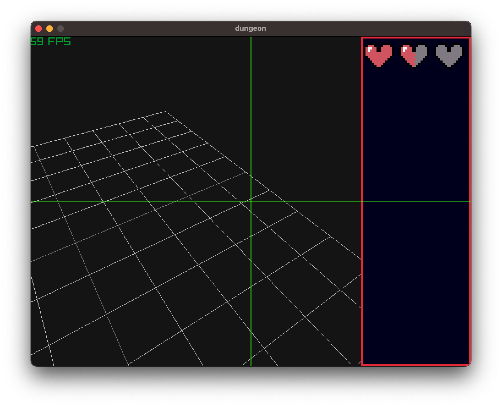

## overview

- this project is to show how to overlay a 3D window with a 2D window
- the idea is to have 2 passes:
    - render the 3D gameplay view into a rectangular area
    - then draw the UI panels around it in 2D.
- The negative source height in `DrawTextureRec` flips the render texture vertically, which is commonly needed with Raylib render textures. 
- `view_width` and `view_height` place the gameplay viewport within the window; use the same rectangle when laying out the surrounding panels.

