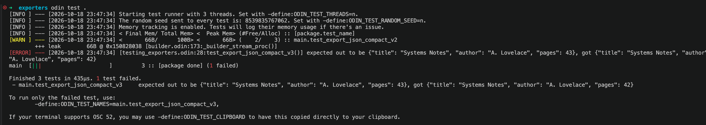

- sources:
    - https://pmbanugo.me/blog/learn-odin-series-05-odin-in-practice
    - https://pmbanugo.me/series/odin-in-an-hour 

---

- This repo shows some basic examples of using the `test` framework
- It uses some examples demo'ing a `Report` output option (`JSON` or `plain_text`)

## Testing
- The Odin test runner automatically looks for any procedure tagged with @(test) across your package, executes them, and tracks memory allocations to flag leaks by default
- compilation (no testing related):
```bash
odin build . -debug -json-errors -show-timings -vet -strict-style

Total Time                         -   365.103 ms - 100.00%
initialization                     -     2.144 ms -   0.58%
parse files                        -    15.483 ms -   4.24%
type check                         -    27.272 ms -   7.46%
LLVM API Code Gen (   78 modules ) -   157.934 ms -  43.25%
ld-link                            -   162.263 ms -  44.44%
```

There are 3 test procs:
- `test_export_json_compact`: all good, no errors
- `test_export_json_compact_v2`: 1 warning related to memory leak (because `defer` is commented) but no errors
- `test_export_json_compact_v3`: 1 error because the expected result is different from the input

The result is really useful
```bash
odin test .                                                      
[INFO ] --- [2026-10-19 00:15:27] Starting test runner with 3 threads. Set with -define:ODIN_TEST_THREADS=n.
[INFO ] --- [2026-10-19 00:15:27] The random seed sent to every test is: 8580000873820. Set with -define:ODIN_TEST_RANDOM_SEED=n.
[INFO ] --- [2026-10-19 00:15:27] Memory tracking is enabled. Tests will log their memory usage if there's an issue.
[INFO ] --- [2026-10-19 00:15:27] < Final Mem/ Total Mem> <  Peak Mem> (#Free/Alloc) :: [package.test_name]
[WARN ] --- [2026-10-19 00:15:27] <       66B/      100B> <       66B> (    2/    3) :: main.test_export_json_compact_v2
        +++ leak        66B @ 0x120410038 [builder.odin:173:_builder_stream_proc()]
[ERROR] --- [2026-10-19 00:15:27] [exporters_testing.odin:28:test_export_json_compact_v3()] expected out to be {"title": "Systems Notes", "author": "A. Lovelace", "pages": 43}, got {"title": "Systems Notes", "author": "A. Lovelace", "pages": 42}
main  [|||                     ]         3 :: [package done] (1 failed)

Finished 3 tests in 392µs. 1 test failed.
 - main.test_export_json_compact_v3     expected out to be {"title": "Systems Notes", "author": "A. Lovelace", "pages": 43}, got {"title": "Systems Notes", "author": "A. Lovelace", "pages": 42}

To run only the failed test, use:
        -define:ODIN_TEST_NAMES=main.test_export_json_compact_v3,

If your terminal supports OSC 52, you may use -define:ODIN_TEST_CLIPBOARD to have this copied directly to your clipboard.
```

- colors are not shown in the `.md` file but it shows that the 2 tests are green while the last one is red

